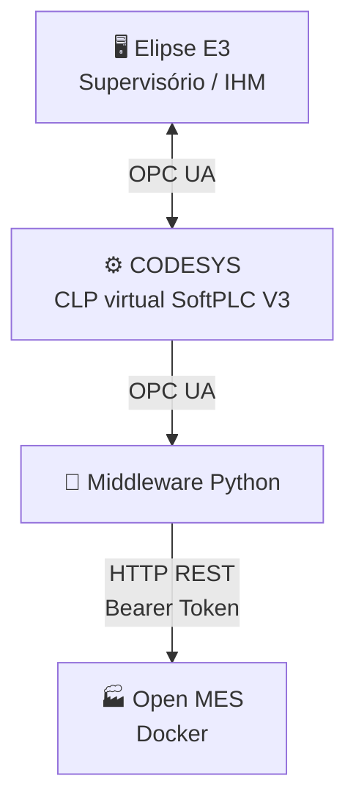
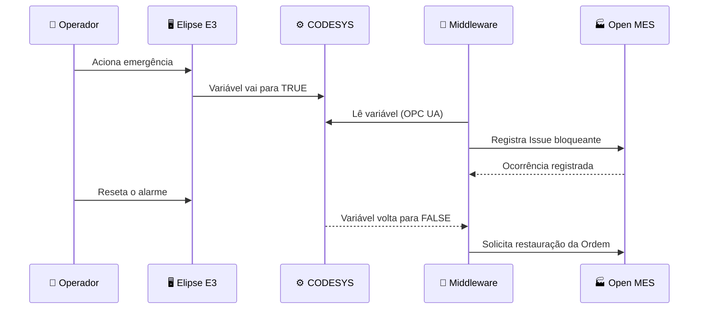
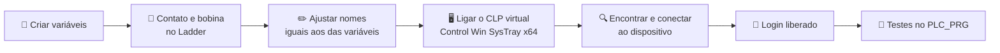

<div align="center">

# 🏭 Integração Industrial
### Elipse E3 ↔ CODESYS ↔ Open MES

Supervisório, CLP virtual e MES trabalhando juntos para automatizar paradas de produção e bloqueios de linha


[📌 Sobre](#-sobre-o-projeto) •
[📊 Status](#-status-do-projeto) •
[🔀 Arquitetura](#-arquitetura-prevista) •
[🖥️ Elipse E3](#️-1-supervisório-de-motor--elipse-e3) •
[⚙️ CODESYS](#️-2-codesys--clp-virtual) •
[🏭 Open MES](#-3-open-mes--planejado) •
[🔌 Integração](#-4-integração--próximos-passos)

</div>

---

## 📌 Sobre o projeto

O objetivo deste projeto é **integrar três sistemas industriais**: um supervisório no **Elipse E3**, um CLP virtual no **CODESYS** e o **Open MES**. Quando um alarme crítico (como uma emergência) for acionado, o evento deve chegar ao MES, que registra a ocorrência e bloqueia a Ordem de Produção correspondente.

Cada parte foi construída e testada **separadamente**. Este README documenta o que já foi feito em cada software e o plano para unir tudo.

---

## 📊 Status do projeto

| Etapa | Descrição | Status |
|:---:|---|:---:|
| 🖥️ | Supervisório de motor no Elipse E3 (telas, tags, gráficos, scripts) | ✅ Concluído |
| ⚙️ | Variáveis, Ladder e teste com CLP virtual no CODESYS | ✅ Concluído |
| 🏭 | Instalação e configuração do Open MES | 🔜 Planejado |
| 🔌 | Comunicação OPC UA entre E3 e CODESYS | 🔜 Planejado |
| 🐍 | Middleware Python (CLP → Open MES) | 🔜 Planejado |
| 🔗 | Integração completa e testes ponta a ponta | 🔜 Planejado |

---

## 🔀 Arquitetura prevista



### 🔧 Responsabilidade de cada componente

| Componente | Papel |
|---|---|
| 🖥️ **Elipse E3** | Interface de supervisão e operação da planta |
| ⚙️ **CODESYS (Control Win V3)** | Executa a lógica do CLP e expõe variáveis via servidor OPC UA |
| 🐍 **Middleware Python** | Monitora as variáveis do CLP e envia requisições REST ao MES |
| 🏭 **Open MES** | Registra ocorrências (Issues) e gerencia o estado das Ordens de Produção |

### 🔁 Fluxo esperado



---

## 🖥️ 1. Supervisório de Motor — Elipse E3

Projeto de supervisório (IHM/SCADA) para **monitorar e acionar um motor**, acompanhando Temperatura, Velocidade, Pressão e Nível, com gráficos de tendência para cada variável.

| Item | Descrição |
|---|---|
| **Plataforma** | Elipse E3 (Studio / Viewer) |
| **Arquivo de domínio** | `cybersistemas_api.dom` |
| **Arquivo de projeto** | `cybersistemas_api.prj` |
| **Linguagem de script** | VBScript (eventos dos objetos) |
| **Fonte de dados** | Servidor de dados interno (`Dados`) com tags simuladas e uma tag interna para o motor |

### ✨ Funcionalidades

- 🔌 **Liga/desliga** do motor pela tela: botão de comando e clique na figura 3D do motor
- 🎨 **Indicação visual do estado**: cores do retângulo, do botão e da figura mudam conforme `Dados.motor.Value`
- 🔢 **Exibição numérica** de Velocidade (RPM), Nível (%), Pressão e Temperatura (°C)
- 📈 **Gráficos de tendência** (E3Chart) para as quatro variáveis
- 🧭 **Navegação** entre telas por botão (Tela Inicial → Gráficos)
- 🔒 **Controle de acesso** do Viewer por lista de IPs

### 🖼️ Telas

#### TelaInicial — Painel de operação

Tela principal, definida como tela inicial do Viewer.

| Objeto | Tipo | Função |
|---|---|---|
| `CommandButton2` | Botão de comando | Liga o motor (alterna `Dados.motor.Value` de 0 para 1) |
| `Figura1` | Figura (`Motors\3DMotor`) | Desliga o motor ao clicar (1 para 0); cor muda conforme o estado |
| `RetanguloArr1` | Retângulo arredondado | Indicador visual do estado (fundo e contorno animados) |
| `CommandButton1` | Botão de comando | Abre a tela **Gráficos** |
| `Texto9` | Texto | `Dados.Velocidade.Value` no formato `0 "RPM"` |
| `Texto8` | Texto | `Dados.Nível.Value` no formato `0 "%"` |
| `Texto7` | Texto | `Dados.Pressão.Value` no formato `0 "P"` |
| `Texto6` | Texto | `Dados.Temperatura.Value` no formato `0 "°C"` |

#### Gráficos — Tendências

| Gráfico | Rótulo | Tag plotada |
|---|---|---|
| `E3Chart1` | Temperatura | `Dados.Temperatura.Value` |
| `E3Chart2` | Velocidade | `Dados.Velocidade.Value` |
| `E3Chart3` | Pressão | `Dados.Pressão.Value` |
| `E3Chart4` | Nível | `Dados.Nível.Value` |

### 🏷️ Tags do projeto

Todas ficam no servidor de dados `Dados`.

| Tag | Tipo | Faixa | Observação |
|---|---|---|---|
| `Dados.Temperatura` | Simulada (DemoTag) | 40 – 100 | Exibida em °C |
| `Dados.Velocidade` | Simulada (DemoTag) | 0 – 100 | Exibida em RPM |
| `Dados.Pressão` | Simulada (DemoTag) | 50 – 200 | |
| `Dados.Nível` | Simulada (DemoTag) | 0 – 100 | Exibido em % |
| `Dados.motor` | Interna (InternalTag) | 0 / 1 | `0` = desligado, `1` = ligado |

### 📜 Scripts (VBScript)

```vbscript
' Botão "Liga" — liga o motor
Sub CommandButton2_Click()
    Application.ToggleValue "Dados.motor.Value", CLng(0), CLng(1)
End Sub

' Figura do motor — desliga o motor
Sub Figura1_Click()
    Application.ToggleValue "Dados.motor.Value", CLng(1), CLng(0)
End Sub

' Botão de navegação — abre a tela de gráficos
Sub CommandButton1_Click()
    Application.GetFrame("").OpenScreen "[Gráficos]?100?0?0", CLng(0)
End Sub
```

> 💡 `Application.ToggleValue "tag", valor1, valor2` alterna a tag entre os dois valores informados. Assim, botão e figura comandam o mesmo motor.

### 👁️ Configuração do Viewer

- **Tela inicial:** `TelaInicial` (frame `_top`)
- **Grupos de Viewers (controle por IP)**, definidos no `.dom`:

| Grupo | Faixa de IP |
|---|---|
| Padrão | `*.*.*.*` (qualquer IP) |
| Local | `127.0.0.1` (somente a própria máquina) |

### ▶️ Como abrir e executar

1. Instale o Elipse E3 (Studio e Viewer)
2. Copie `cybersistemas_api.dom` e `cybersistemas_api.prj` para a mesma pasta
3. Abra o **E3 Studio** e carregue o domínio `cybersistemas_api.dom`
4. Inicie o **Servidor** do domínio e depois abra o **Viewer**
5. Na `TelaInicial`, clique no botão para ligar o motor, na figura para desligar, e use o botão de navegação para ver os gráficos

### ⚠️ Pontos de atenção

- **Unidade de pressão:** o formato `0 "P"` merece uma unidade explícita (bar, psi ou kPa)
- **Liga e desliga em objetos diferentes:** um botão "Desliga" dedicado deixaria a operação mais intuitiva
- **Tags simuladas:** para usar com um motor real, é preciso ligá-las a um driver de comunicação (CLP, inversor etc.)
- **Imagens de fundo:** as telas usam caminho absoluto do computador de origem; em outra máquina, reaponte a propriedade `PictureFile` de cada tela
- **Requisitos:** Windows com WebView2 Runtime. A versão exata do E3 não foi identificada nos arquivos

---

## ⚙️ 2. CODESYS — CLP virtual

Projeto de teste criado no **CODESYS V3.5 SP21 Patch 1** para validar o funcionamento das variáveis em um CLP virtual, antes da integração com os outros sistemas.

| Item | Descrição |
|---|---|
| **IDE** | CODESYS V3.5 SP21 Patch 1 |
| **CLP virtual** | CODESYS Control Win SysTray – x64 |
| **Linguagem** | Ladder (LD) |
| **Programa de teste** | `PLC_PRG` |

### 🧪 O que foi feito



1. **Criação das variáveis** no projeto.
2. **Montagem do Ladder** na seção dedicada, com **contato e bobina**.
3. **Ajuste dos nomes** do contato e da bobina para os mesmos nomes das variáveis, e conferência.
4. **Ligação do CLP virtual** (CODESYS Control Win SysTray – x64).
5. **Busca e conexão** ao CLP virtual, o que liberou a opção de **login**.
6. **Testes no `PLC_PRG`**: alteração do campo **"Valor preparado"** da variável e confirmação para o CLP com o atalho **`Ctrl + F7`** (escrever valores).

### ⌨️ Atalho útil

| Atalho | Ação |
|:---:|---|
| `Ctrl + F7` | Escreve os valores preparados no CLP |

---

## 🏭 3. Open MES — planejado

O Open MES receberá as ocorrências geradas pelos alarmes e gerenciará o estado das Ordens de Produção. Ainda **não foi instalado** neste projeto; abaixo está o plano.

### 🐳 Instalação com Docker

Crie um `docker-compose.yml`:

```yaml
services:
  openmes-app:
    image: openmes/openmes:latest
    container_name: openmes_app
    restart: always
    ports:
      - "8081:80"
    environment:
      APP_ENV: production
      APP_KEY: ${APP_KEY}
      DB_CONNECTION: sqlite
    volumes:
      - openmes_data:/var/www/html/storage

volumes:
  openmes_data:
```

```bash
docker compose up -d     # sobe o container
docker ps                # confere se está rodando
```

Depois acesse 👉 **http://localhost:8081**

> ⚠️ Configure uma `APP_KEY` válida conforme a documentação da imagem e confirme a disponibilidade e os requisitos da imagem Open MES antes de iniciar.

### 🔑 Token de API

1. Acesse o painel do Open MES
2. Entre em **Settings → API Tokens**
3. Clique em **Create Token** e dê um nome (ex.: `Integracao_Python`)
4. Copie o token e guarde em variável de ambiente

> 🔒 Nunca publique tokens, senhas ou chaves de API no GitHub.

---

## 🔌 4. Integração — próximos passos

### 4.1 CODESYS expondo variáveis via OPC UA

1. Crie uma **GVL** com a variável de alarme, por exemplo:

```
VAR_GLOBAL
    bAlarmeEmergencia : BOOL := FALSE;
    nPecasProduzidas  : DINT := 0;
END_VAR
```

2. Na aplicação, clique com o botão direito e escolha **Add Object → Symbol Configuration**
3. Compile com **Build**
4. Selecione a GVL e habilite `bAlarmeEmergencia` para leitura (e escrita, se necessário)
5. Execute o programa no CODESYS Control Win V3

Endereço padrão do servidor OPC UA: `opc.tcp://localhost:4840`

### 4.2 Elipse E3 conectado ao CODESYS

1. Adicione o **driver OPC UA** compatível com a instalação
2. Configure a conexão com o servidor OPC UA do CODESYS
3. Localize a variável `GVL.bAlarmeEmergencia`
4. Associe o botão de emergência da IHM a essa variável

### 4.3 Middleware Python

Estrutura sugerida:

```
Integracao-Industrial/
├── main.py
├── .env
├── .gitignore
├── docker-compose.yml
└── README.md
```

Dependências:

```bash
pip install requests python-opcua python-dotenv
```

Arquivo `.env`:

```env
OPENMES_URL=http://localhost:8081/api/v1
OPENMES_TOKEN=SEU_TOKEN_AQUI

OPC_SERVER_URL=opc.tcp://localhost:4840
OPC_TAG_ALARME=ns=4;s=|var|CODESYS Control Win V3 x64.Application.GVL.bAlarmeEmergencia

WORK_ORDER_ID=1
LINE_ID=1
```

> O Node ID da variável OPC UA deve corresponder ao endereço efetivamente disponibilizado pelo CODESYS.

<details>
<summary>📄 <b>Rascunho do <code>main.py</code> (clique para expandir)</b></summary>

```python
import os
import time
import requests

from dotenv import load_dotenv
from opcua import Client

load_dotenv()

OPENMES_URL = os.getenv("OPENMES_URL")
OPENMES_TOKEN = os.getenv("OPENMES_TOKEN")
OPC_SERVER_URL = os.getenv("OPC_SERVER_URL")
OPC_TAG_ALARME = os.getenv("OPC_TAG_ALARME")
WORK_ORDER_ID = int(os.getenv("WORK_ORDER_ID", 1))
LINE_ID = int(os.getenv("LINE_ID", 1))

HEADERS = {
    "Authorization": f"Bearer {OPENMES_TOKEN}",
    "Content-Type": "application/json",
    "Accept": "application/json",
}


def bloquear_producao_no_mes():
    """Registra um Issue bloqueante no Open MES."""
    print(f"\n🚨 [INTEGRAÇÃO MES] Processando bloqueio na Linha #{LINE_ID}...")

    requests.put(
        f"{OPENMES_URL}/work-orders/{WORK_ORDER_ID}",
        json={"status": "in_progress"},
        headers=HEADERS,
        timeout=10,
    )

    payload_issue = {
        "work_order_id": WORK_ORDER_ID,
        "line_id": LINE_ID,
        "issue_type_id": 5,
        "title": "Alarme Crítico de Emergência - CODESYS",
        "description": "Linha paralisada via interrupção do CLP / Elipse E3",
        "severity": "critical",
        "is_blocking": True,
        "status": "open",
    }

    res = requests.post(
        f"{OPENMES_URL}/issues", json=payload_issue, headers=HEADERS, timeout=10
    )

    if res.status_code in [200, 201]:
        print(f"--> [SUCESSO] Ocorrência registrada para a Ordem #{WORK_ORDER_ID}!")
        return True

    print(f"--> [ERRO] Falha ao registrar bloqueio: {res.text}")
    return False


def desbloquear_producao_no_mes():
    """Solicita a restauração da Ordem de Produção."""
    print(f"\n✅ [INTEGRAÇÃO MES] Restaurando Ordem #{WORK_ORDER_ID}...")

    res = requests.put(
        f"{OPENMES_URL}/work-orders/{WORK_ORDER_ID}",
        json={"status": "in_progress"},
        headers=HEADERS,
        timeout=10,
    )

    if res.status_code in [200, 201]:
        print(f"--> [SUCESSO] Ordem #{WORK_ORDER_ID} restaurada para IN_PROGRESS!")
        return True

    print(f"--> [ERRO] Falha ao restaurar ordem: {res.text}")
    return False


def executar_monitoramento_opc_ua():
    """Monitora a variável de emergência via OPC UA."""
    client = Client(OPC_SERVER_URL)
    conectado = False

    try:
        print(f"Conectando ao servidor OPC UA: {OPC_SERVER_URL}")
        client.connect()
        conectado = True
        print("✅ Conexão OPC UA estabelecida!")

        node_alarme = client.get_node(OPC_TAG_ALARME)
        estado_alarme_anterior = False

        while True:
            alarme_atual = node_alarme.get_value()

            # Borda de subida: False -> True
            if alarme_atual and not estado_alarme_anterior:
                if bloquear_producao_no_mes():
                    estado_alarme_anterior = True

            # Borda de descida: True -> False
            elif not alarme_atual and estado_alarme_anterior:
                if desbloquear_producao_no_mes():
                    estado_alarme_anterior = False

            time.sleep(0.5)

    except KeyboardInterrupt:
        print("\nMonitoramento finalizado pelo usuário.")
    except Exception as e:
        print(f"\nErro na integração: {e}")
    finally:
        if conectado:
            client.disconnect()


if __name__ == "__main__":
    executar_monitoramento_opc_ua()
```

</details>

> 📝 **Nota técnica:** endpoints, campos, códigos de status e identificadores do exemplo devem ser conferidos na documentação da API da versão instalada do Open MES. Criar um Issue bloqueante não garante, por si só, que a Ordem de Produção vá para `BLOCKED`; essa transição precisa estar implementada e validada no MES.

### ✅ Checklist antes de testar a integração

- [ ] Docker instalado e Open MES acessível
- [ ] Token de API configurado no `.env`
- [ ] CODESYS Control Win V3 em modo **Online / Run**
- [ ] Servidor OPC UA ativo
- [ ] Elipse E3 conectado ao CLP
- [ ] Node ID da variável de emergência correto
- [ ] Ordem de Produção e linha configuradas no Open MES

### 🎯 Resultado esperado

| Ao acionar a emergência | Resultado |
|---|---|
| 🖥️ Elipse E3 | Identifica o acionamento |
| ⚙️ CODESYS | Variável vai para `TRUE` |
| 🐍 Middleware | Detecta o alarme via OPC UA |
| 🏭 Open MES | Registra ocorrência crítica e exibe o Issue bloqueante |
| 📋 Work Orders | Ordem passa para `BLOCKED` |

| Ao resetar o alarme | Resultado |
|---|---|
| ⚙️ CODESYS | Variável volta para `FALSE` |
| 🐍 Middleware | Identifica o reset |
| 🏭 Open MES | Solicita restauração da Ordem |
| 📋 Work Orders | Volta para `IN_PROGRESS`, conforme as regras do MES |

---

## 🔒 Segurança e boas práticas

- 🚫 Nunca publique tokens de API ou senhas no GitHub
- 🔐 Use variáveis de ambiente para dados confidenciais
- 👮 Configure autenticação e permissões no OPC UA
- 🔒 Use comunicação segura em ambientes de produção
- 📝 Implemente logs de eventos e falhas
- ✔️ Valide as respostas da API antes de alterar o estado da integração
- ♻️ Evite o registro duplicado de ocorrências
- 🛑 Não use o reset do alarme como única condição para liberar a linha: a liberação deve depender também da confirmação de segurança e das regras operacionais da planta

`.gitignore` recomendado:

```
.env
.venv/
venv/
__pycache__/
*.pyc
.vscode/
```

---

## 🎯 Objetivo da solução

Conectar os níveis de **automação industrial** e **gestão da produção**, refletindo no MES os eventos críticos do chão de fábrica. Com isso é possível:

- ⚡ Automatizar o registro de paradas industriais
- 🔗 Melhorar a comunicação entre CLP, supervisório e MES
- 🗂️ Centralizar ocorrências e bloqueios de produção
- 🔎 Aumentar a rastreabilidade dos eventos
- 📉 Reduzir a dependência de registros manuais
- 📋 Facilitar o acompanhamento das Ordens de Produção

---

## 📄 Licença

Este projeto está disponibilizado sob a licença **MIT**.

<div align="center">

Desenvolvido para integração de sistemas industriais, automação e gestão da produção 🏭

</div>
